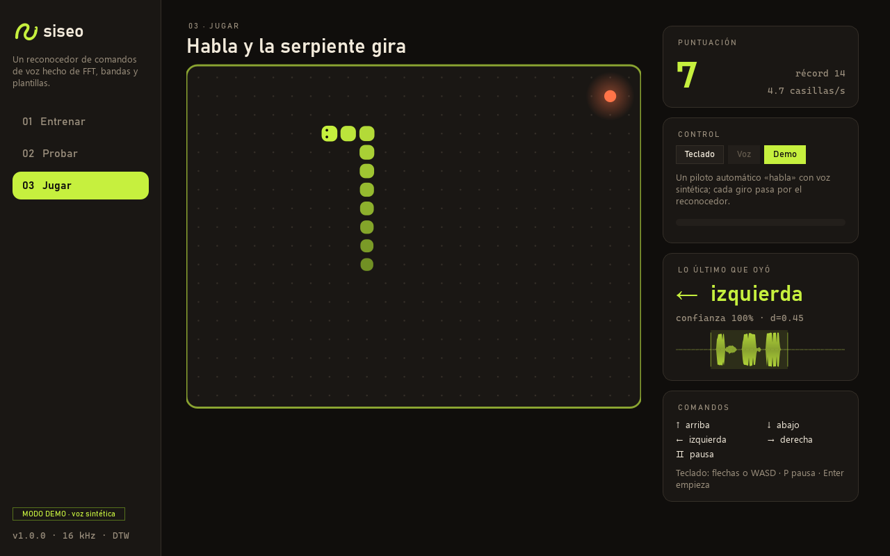
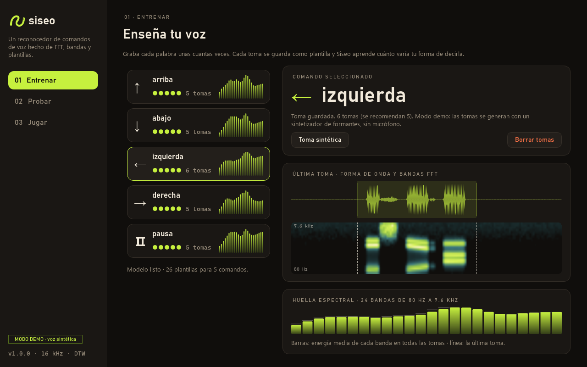
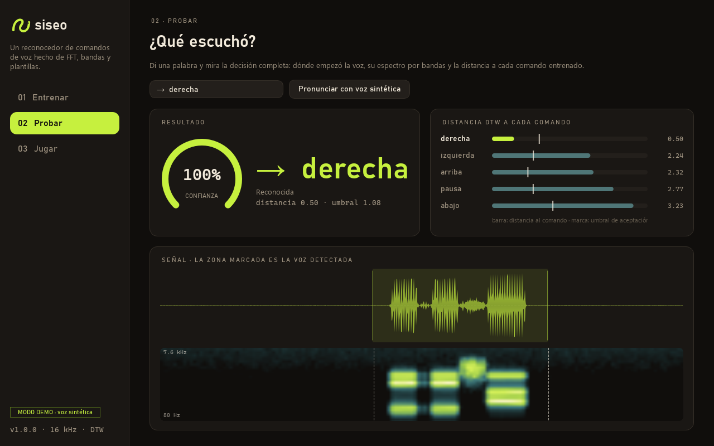
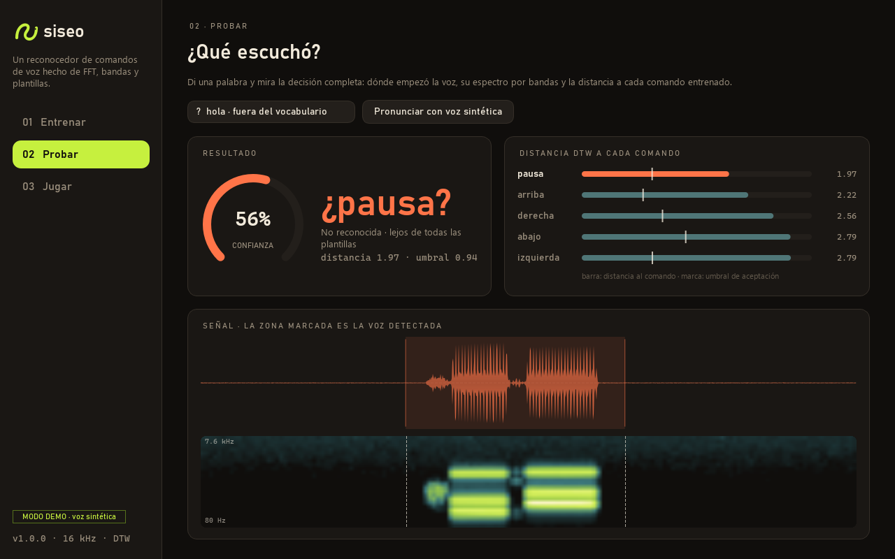
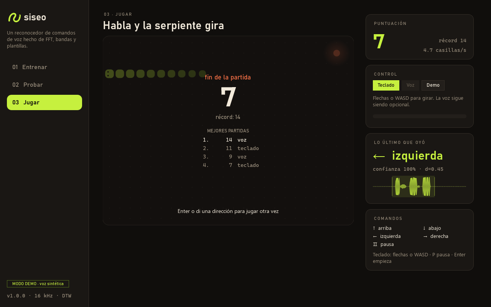

# Siseo

**Una serpiente que obedece a tu voz.** Siseo es un pequeño juego de escritorio: entrenas cinco palabras con tu propia voz y luego guías a la serpiente diciendo *arriba*, *abajo*, *izquierda*, *derecha* o *pausa*. Por dentro hay un reconocedor de comandos de voz hecho solo con procesamiento de señales: FFT, energía por bandas de frecuencia y comparación con plantillas. Sin redes neuronales y sin servicios en la nube.



## Qué hace

- **Entrenar**: grabas cada palabra unas cuantas veces. Cada toma se guarda como plantilla y se ve su forma de onda, su espectrograma por bandas y la *huella espectral* del comando.
- **Probar**: dices una palabra y ves la decisión completa: dónde empezó la voz, la distancia a cada comando, el umbral de aceptación y la confianza. Si la palabra no se parece lo suficiente a nada, se rechaza.
- **Jugar**: Snake controlado por voz con escucha continua. El teclado (flechas o WASD) siempre funciona como respaldo y guarda los récords.
- **Modo demo**: un sintetizador de formantes «pronuncia» las palabras, así se puede ver todo funcionando sin micrófono. En el juego, un piloto automático habla con esa voz sintética y cada giro pasa por el reconocedor.

## Capturas

| Entrenar | Probar |
| --- | --- |
|  |  |
| **Palabra rechazada** | **Fin de la partida** |
|  |  |

Las capturas se generan con la aplicación real en modo demo (`scripts/capture_screenshots.py`); todas las voces que aparecen son sintéticas.

## Instalación

Requiere Python 3.11 o superior.

```bash
python -m venv .venv
# Windows: .venv\Scripts\activate    ·    Linux/macOS: source .venv/bin/activate
pip install .
```

En Linux, el micrófono necesita PortAudio: `sudo apt install libportaudio2`. En Windows y macOS viene incluido.

## Uso

```bash
siseo           # abre la aplicación con tu micrófono
siseo --demo    # voz sintética y plantillas de demostración, sin micrófono
```

Opciones: `--device N` elige el micrófono, `--db RUTA` cambia la base de datos y `--page jugar` abre directamente el juego.

Teclado en el juego: flechas o WASD para girar, **P** para pausar y **Enter** para empezar o volver a jugar.

## Entrena tu voz

1. Abre **Entrenar**, elige un comando y pulsa **Grabar toma**. Tienes 1,6 segundos para decir la palabra.
2. Repite hasta tener unas cinco tomas por comando (con dos ya funciona). Habla con naturalidad y con el mismo micrófono con el que vas a jugar.
3. Ve a **Probar** y comprueba que cada palabra se reconoce. Si una falla a menudo, añade más tomas o borra las que salieron mal.
4. En **Jugar**, elige **Voz** y espera un instante a que mida el ruido de la habitación antes de hablar.

Las tomas y los récords se guardan en `~/.siseo/siseo.db` (o en la carpeta indicada por la variable `SISEO_HOME`).

También hay una herramienta de línea de comandos:

```bash
siseo-cli devices                       # micrófonos disponibles
siseo-cli record arriba --takes 5       # grabar tomas
siseo-cli import abajo grabaciones/*.wav
siseo-cli recognize prueba.wav
siseo-cli eval carpeta/ derecha         # precisión sobre una carpeta
siseo-cli demo                          # prueba con voz sintética
```

## Cómo reconoce

1. **Detección de voz**: la energía de cada trama de 10 ms se compara con el nivel de ruido; la palabra es la zona que lo supera en 12 dB.
2. **Bandas FFT**: cada trama de 25 ms pasa por una ventana de Hamming y una FFT. El espectro se agrupa en **24 bandas** en escala mel (de 80 Hz a 7,6 kHz) y se toma el logaritmo de la energía de cada banda. Es la idea original del proyecto, energía por bandas de frecuencia, aplicada trama a trama.
3. **Normalización**: se recortan los 20 dB más bajos y se resta la media de cada banda, así el volumen y el micrófono importan poco.
4. **Comparación**: con DTW (*dynamic time warping*) se alinea la palabra con cada plantilla aunque se haya dicho más rápido o más lento. Gana el comando con la plantilla más cercana.
5. **Rechazo**: cada comando tiene un umbral aprendido de lo mucho que varían sus propias tomas. Si la distancia lo supera, o si dos comandos quedan casi empatados, la palabra se descarta en lugar de girar al lado equivocado.

## Pruebas

```bash
pip install ".[dev]"
pytest
```

La suite cubre el procesamiento de señal con señales sintéticas (tonos, chirps y ruido), la detección de voz, DTW, el reconocimiento y el rechazo, la base de datos SQLite, la lógica del juego sin interfaz, la CLI y pruebas de humo de la interfaz con pytest-qt en modo *offscreen*.

## Estructura

```text
src/siseo/
  dsp/           señal, bandas FFT, detección de voz y DTW
  recognition/   análisis de un clip y comparación con plantillas
  game/          reglas de Snake y piloto automático, sin dibujo
  ui/            interfaz PySide6: tema, widgets y las tres pantallas
  synth.py       sintetizador de formantes para el modo demo
  store.py       SQLite: tomas y récords
  engine.py      el reconocedor completo
  app.py, cli.py puntos de entrada
```

## Contexto académico

Siseo nació en 2022 como proyecto universitario de reconocimiento de voz en tiempo real: grabar palabras, calcular la energía promedio por bandas de su FFT y decidir qué palabra se dijo para mover una serpiente. Esta versión conserva esa idea y la completa con detección de voz, normalización, DTW y rechazo, además de una interfaz propia.

## Licencia

[MIT](LICENSE) © 2022–2026 Kevin Martinez
